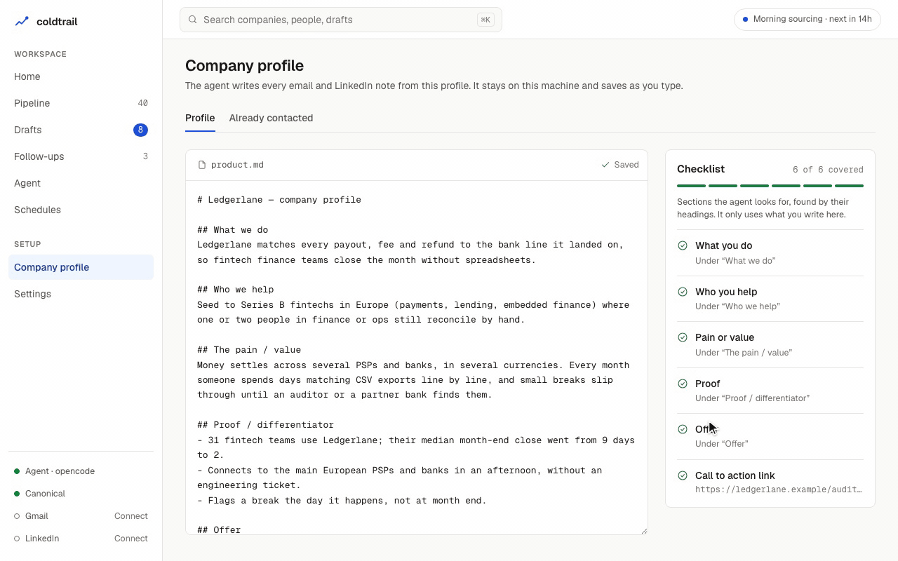

# coldtrail

> **Discovery-first cold outreach for solo founders & one-person sales teams.**
> Find the companies other tools miss, draft each touch in your own voice, send from your own
> email (Gmail) and LinkedIn — all on your machine. Built on [Canonical](https://trycanonical.ai).

Most outreach tools start from a list you already have and optimize the *sending*. coldtrail
starts from the opposite end: **discovery**. You describe who you want to reach in plain English;
Canonical returns verified, long-tail companies the big databases miss; an agent enriches a
founder contact, writes a genuinely personalized email from *your* company profile, and (only if
you say so) sends it. No CRM to feed, no seat to buy, nothing leaves your laptop except the
emails you approve.

`coldtrail` is a single binary. Run it and it opens a **local app in your browser** — an **Agent**
screen where an agent (Claude Code / Codex / opencode, or your own model) sources, enriches, and
drafts, plus **Home**, the **Pipeline**, **Drafts**, **Follow-ups**, **Schedules**, an editable
**Company profile**, and **Settings**.

## Demo



_Your **company profile** → a **run** with the agent (source → enrich → draft) → the
**pipeline** of verified companies → a **personalized draft** ready to send → the numbers on
**Home**. ([higher-quality MP4](docs/demo.mp4))_

## Install

```bash
curl -fsSL https://raw.githubusercontent.com/dilpreet92/coldtrail/main/install.sh | bash
```

You need a **provider** (the brain): [Claude Code](https://claude.com/claude-code) (`claude`) or
[Codex](https://github.com/openai/codex) (`codex`) — which reuse your existing subscription —
[opencode](https://opencode.ai) (`opencode`, with whatever providers you've signed it into), or
any OpenAI-compatible endpoint / local **Ollama**. The installer checks for one and tells you how
to get it if it's missing. Then:

```bash
coldtrail            # opens the app at http://127.0.0.1:8787
```

coldtrail keeps itself current: on launch it checks for a newer release and updates in place
before starting (run `coldtrail update` to do it on demand, or `COLDTRAIL_NO_UPDATE=1 coldtrail`
to skip the check).

## Getting set up (first run)

The browser opens to a short guided **Setup** (`#/setup`) — four steps, with Back / Continue:

1. **Agent** — pick Claude Code / Codex / opencode, or point at your own OpenAI-compatible/Ollama
   model. Each card shows whether that agent is installed and signed in, with the install or
   login command to copy if not; **Test connection** checks it really answers. For opencode,
   pick the model from the list `opencode models` gives (or type one) — it's saved as
   `opencode_model` in `~/.coldtrail/config.toml`, so scheduled runs don't depend on whatever you
   last used in its TUI.
2. **Canonical** (sourcing). Keyless: click **Connect Canonical** and approve in the browser.
3. **Your company** — chat-free, just an editable profile, with a checklist beside it that ticks
   off what the agent needs: what you do, who you help, the pain you solve, proof, your offer,
   and a call to action with a `- Link:` line. The agent writes **every email from this**, in
   your words — it never invents claims. It saves as you type; edit it anytime in **Company
   profile**.
4. **Where outreach goes** — Gmail, LinkedIn, or both. Easiest for Gmail is an **app password**
   (keyless, ~2 min): turn on 2-Step Verification, create an app password, enable IMAP. (More
   options: bring your own Google OAuth client instead.) For LinkedIn, see
   [LinkedIn destination](#linkedin-destination) below. **Skip for now** is fine — connect either
   one later in Settings → Connections.

"You're set" then offers two first steps — open the Agent with a starter request filled in
(nothing runs until you send it), or create a schedule — and takes you Home. You can run the
guided setup again from **Settings**.

## The app

Every screen has its own address, so back/forward, refresh and bookmarks work:

| Screen | Route | What it's for |
|---|---|---|
| **Home** | `#/home` | what needs you (drafts waiting, follow-ups due, replies, connection problems), your numbers, the funnel (sourced → contact found → drafted → sent → replied), recent runs, top searches |
| **Pipeline** | `#/pipeline` | every sourced company, 50 a page, with search, stage and "Sourced by" filters; `#/pipeline/<domain>` opens a company's contacts, outreach history and source, with **Ask agent to enrich / draft** (fills in the Agent, you press Send) and **Skip / Restore** |
| **Drafts** | `#/drafts` | the review queue — All / Email / LinkedIn, J/K to move, edits save as you type; `#/drafts/<domain>` opens one |
| **Follow-ups** | `#/followups` | Due / Awaiting / Replied / Bounced; draft a follow-up, mark replied or bounced, **Check for replies** |
| **Agent** | `#/agent` | conversations with the agent — your chats and scheduled runs; `#/agent/<id>` opens one |
| **Schedules** | `#/schedules` | named schedules and the run history ([below](#schedules--scheduled-runs)) |
| **Company profile** | `#/company` | your profile (`product.md`) and the **Already contacted** list |
| **Settings** | `#/settings` | tabs for Agent, Connections, Sending, Enrichment (OSINT installers), Appearance |
| **Setup** | `#/setup` | the guided first run above |

⌘K / Ctrl+K searches companies, people and drafts from anywhere. The sidebar shows live counts and
one status dot per connection; the top bar shows the next scheduled run. Light and dark follow
your system, or pick one in Settings → Appearance. Coming from v0.10? Overview is now **Home**,
Chat is **Agent**, Cron is **Schedules**, and Company is **Company profile**.

## How a run works

In **Agent**, say something like _"find companies for &lt;my ICP&gt; and draft intros."_ The agent
runs the whole loop (its tool calls fold into "Worked · N steps"; **Stop** ends a turn):

1. **Source (Canonical).** It plans several diverse search angles (expanding acronyms/regions into
   real phrasings), searches them in parallel, and imports the **union deduped by domain** — so
   you cover the long tail without double-contacting anyone.
2. **Enrich.** A founder contact per company, working down coldtrail's technique ladder (OSINT
   tools, GitHub commit metadata, crt.sh, WHOIS, on-domain) — an MX-verified, founder-addressed
   email, or a verified LinkedIn profile URL; either makes a company reachable.
3. **Draft.** A tailored subject + body per company, composed fresh from your Company profile and
   what the company actually does. Nothing is sent verbatim.
4. **Send — your call.** By default drafts wait for you on the **Drafts** screen. If you've
   turned on **auto-send**, the agent asks _"send these now?"_ and, on your yes, sends them (under
   your daily cap). It works in **warmup-sized batches** (~5 at a time) so you never outrun a
   healthy pace.

```
Canonical (sourcing)      ← plain-English ICP → verified companies the big DBs miss
        │
        ▼
local SQLite              ← deduped by domain, one status per company (no double-contact)
        │
        ▼
enrichment                ← founder email or LinkedIn URL per company (OSINT ladder · your key · by hand)
        │
        ▼
draft (your voice)        ← personalized from your Company profile; never verbatim
        │
        ▼
send                      ← drafts by default; opt-in auto-send (capped) when you trust it
```

## Sending: off by default, yours to turn on

The standing default is **draft-only** — a human reviews and sends every message. When you're
confident the drafts are good, flip on **Auto-send** in Settings → Sending (with a daily cap; it
asks you to confirm before it turns on). Then the Drafts screen sends for real on your click, and
the agent can send within a run after you confirm. Sending is gated two ways — it won't fire
unless *both* auto-send is on *and* you say yes — so nothing goes out by accident. On the Drafts
screen, each send button names who it goes to, the first send of a browser session asks first,
and **Send all…** states exactly what will go out (and what your caps hold back) before anything
does.

## Schedules — scheduled runs

The **Schedules** screen runs coldtrail while you're away. Create any number of **named schedules**,
each with its own cadence — **daily** or **weekly** at a time you pick (weekly also picks a
weekday) — and its own **task**: either **agent decides**, where the agent plans fresh, diverse
search queries from your `product.md` profile and what it's already sourced, or a **custom
prompt** you write yourself (e.g. _"source 20 companies like Linear and draft intros"_). Each
schedule installs exactly **one OS timer** — macOS `launchd` (`ai.coldtrail.run.<id>`) or Linux
`systemd` (`coldtrail-<id>`) — so schedules survive reboots and don't depend on coldtrail staying
open. Each schedule's row has an on/off switch, its **next run** and **last run**, and a ⋯ menu
with Edit, Delete, and two actions that jump straight to the run's conversation in **Agent** and
follow it live: **Run now** (runs it immediately, same as its scheduled trigger; it asks first
when auto-send is on) and **Dry run** (drafts only — it hard-gates every send, so nothing goes out
no matter your auto-send settings). The create/edit dialog previews the next three run times and
says what the schedule may send with your current settings. Below the schedules, a **run
history** lists every run with its counts and a link to its conversation. Every run uses the agent
you picked in Setup — switch it in Settings → Agent (e.g. to opencode) and the schedules follow.

A scheduled run (and a manually triggered "Run now") does the full loop — source → enrich →
draft — and then **sends per your existing config**: emails go out if **auto-send** is on (under
its daily cap), and LinkedIn connection requests go out if **LinkedIn auto-send** is on (via the
same paced, daily- and weekly-capped sender used everywhere else). Leave both off and a schedule
only ever produces drafts for you to review.

One caveat worth knowing: LinkedIn sends drive a real, human-visible Chrome window, so a
scheduled LinkedIn send only completes if the machine is awake, you're logged in, the screen is
unlocked, and LinkedIn is connected at run time — otherwise it fails safe (nothing sent, the
draft stays in **Drafts** for you to send by hand later). Email sends need no browser and aren't
affected by machine/screen state.

## LinkedIn destination

Contacts don't always have a findable email — coldtrail can also reach a founder on
LinkedIn. When enrichment finds only a LinkedIn profile URL (no MX-verified email), the agent
writes a short connection note instead of an email draft. One touch per company either way —
never both channels.

**Connect.** In Settings → Connections (or Setup's last step), click **Connect LinkedIn** (or run
`coldtrail linkedin connect`): coldtrail opens a real, human-visible Chrome window at
LinkedIn's login page and waits up to three minutes for you to log in yourself — coldtrail
never sees or stores your password. Once you're in, it saves the connection state and reuses
that Chrome profile for every LinkedIn action after.

**Assist by default, gated auto-send.** Every LinkedIn note lands on the **Drafts** screen
first, with a live 300-character counter. The default hand-off is **Open in LinkedIn** —
coldtrail drives the browser through Connect → Add a note → fill your text, then stops and lets
you click **Send** yourself; Drafts then asks "Did it send?" so it can mark the invite. If you
flip on **LinkedIn auto-send** in Settings → Sending (a separate switch from email auto-send),
Drafts gains a **Send invite** button and the agent can drive all the way through Send after you
say yes in the conversation — same two-part gate as email (opt-in + explicit yes), just tracked
per channel. A draft auto-send had to skip (say, LinkedIn wants the person's email) says why and
waits for you to open it by hand.

**Caps, pacing, and account safety.** LinkedIn's terms restrict automated activity, and
aggressive, bursty, or off-hours connection requests are what gets accounts restricted — so
auto-send is deliberately conservative and opt-in: a rolling weekly cap (80 by default) and a
daily sub-cap (15 by default), both configurable; sends only inside a daytime local-hours
window (08:00–20:00); only one Chrome session driving your profile at a time; and every send
is verified on-screen before it's recorded — coldtrail never marks an invite "sent" without
observing LinkedIn's own confirmation. Assist mode has no cap because a human is doing the
actual clicking.

**Where the session lives.** LinkedIn's cookies/session live in a coldtrail-owned Chrome
profile directory outside the agent's workspace, next to your other secrets — in your OS
config dir (`dirs::config_dir()`): `~/Library/Application Support/coldtrail/linkedin-profile`
on macOS, `~/.config/coldtrail/linkedin-profile` on Linux, `%APPDATA%\coldtrail\linkedin-profile`
on Windows — created with locked-down (0700) permissions. It holds only the browser session,
never a password. The workspace agent that runs shell commands can't read it.

## Guardrails baked in

- **Dedupe by domain** — you can't double-contact a company.
- **Founder-addressed, verified.** An email contact is MX-verified — generic (`info@`/`sales@`)
  and placeholder addresses are rejected, so guessed addresses don't bounce. A LinkedIn-only
  contact is verified by being a real profile URL instead.
- **No fabrication** — emails are written from your profile and real facts about the company.
- **Draft-first, gated send** — sending is off until you enable it, capped for warmup, and the
  agent can only trigger `coldtrail send` (it never touches your credentials or mail APIs directly).

## Everything stays local

State lives in `~/.coldtrail/` — the SQLite pipeline, your `product.md` profile, the agent brief
(`CLAUDE.md`), the enrichment playbook, and config. **Credentials live outside the workspace**
(in a sibling secrets dir), so the agent that runs shell commands can't read them. The app binds
`127.0.0.1` only, guarded by a one-time token in the URL. Nothing leaves your machine except the
emails you approve.

## Command-line surface

Bare `coldtrail` serves the app; every step also runs headless for power users / CI:

```bash
coldtrail serve --port 9000 --no-open    # serve without opening a browser
coldtrail setup                          # terminal setup wizard (idempotent)
coldtrail agent                          # raw terminal agent in the workspace
coldtrail linkedin connect               # open Chrome, log into LinkedIn, save the session
coldtrail linkedin status                # print the persisted LinkedIn connect state
```

| Command | What it does |
|---|---|
| `coldtrail source "<angle>" ["<angle>" …]` | source from Canonical across angles, deduped by domain |
| `coldtrail add-contact <domain> "<Name>" [email] [--linkedin <url>] [source]` | add a founder contact — email (MX-verified), LinkedIn URL, or both |
| `coldtrail find-emails [max]` | best-effort OSINT founder-email finder |
| `coldtrail draft <domain> --subject "…" --body "…"` | store a personalized draft (never sends) |
| `coldtrail linkedin-note <domain> --note "…"` | store a ≤300-char LinkedIn connection note (never sends) |
| `coldtrail send <domain>` | send a reviewed draft for real, either channel (refuses unless that channel's auto-send is on) |
| `coldtrail followup <domain> --subject "…" --body "…"` | store a follow-up touch |
| `coldtrail mark <domain> <sent\|replied\|bounced>` | advance status |
| `coldtrail seed` | load already-contacted domains from `contacted.toml` |

## Build from source

```bash
git clone https://github.com/dilpreet92/coldtrail && cd coldtrail
cargo build --release          # -> target/release/coldtrail
cargo test
```

## Development

The browser app is plain ES modules and CSS under `ui/` (no framework, no bundler, no Node step
in `cargo build`), embedded into the binary. Two test suites cover it besides `cargo test`:

```bash
cargo build && cd tests/e2e && npm install && npx playwright install chromium && npx playwright test
node --test tests/js/          # from the repo root: unit tests for the browser modules
```

The end-to-end suite drives a real `coldtrail serve` (the `target/debug` build) in a throwaway
`COLDTRAIL_HOME` seeded with a fake workspace, with sending, OS timers and self-update switched
off and a fake `opencode` first on `PATH`; anything that would open Chrome, OAuth or LinkedIn is
intercepted in the page. It never touches `~/.coldtrail`, your secrets, LaunchAgents, Gmail,
Canonical, LinkedIn or a real model.

## Powered by Canonical

The sourcing engine is [Canonical](https://trycanonical.ai) — verified, long-tail company search,
available as an [MCP server](https://github.com/vy-labs/canonical-mcp) and a ChatGPT app. Free
tier: 250 credits, no card.

## License

MIT. Built in public by a solo maintainer — no roadmap or SLAs, but issues and PRs are welcome if
the bones are useful for your own outreach.
